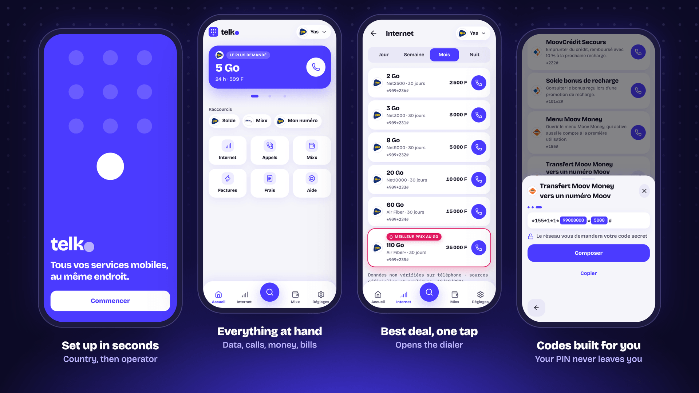
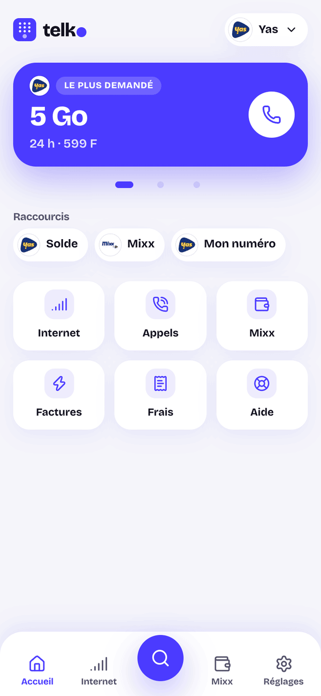

<div align="center">

<a href="https://telko.pages.dev">
  <picture>
    <source media="(prefers-color-scheme: dark)" srcset="docs/readme/logo-dark.svg">
    
  </picture>
</a>

### Every mobile code in Africa, one tap away.

Data bundles, mobile money, bills and USSD codes, sourced, dated and ready to dial.<br>
Free, open source, works offline.

[](https://telko.pages.dev)

[](https://github.com/gausoft/telko/actions/workflows/ci.yml)
[](#countries)
[](docs/offline.md)
[](LICENSE)
[](data/LICENSE)
[](CONTRIBUTING.md)

[**Open the app**](https://telko.pages.dev) · [Roadmap](ROADMAP.md) · [Contribute](CONTRIBUTING.md) · [Report a broken code](https://github.com/gausoft/telko/issues/new?template=broken-code.yml)

<br>



</div>

## See it in action

<table>
<tr>
<td width="300" align="center">
  
</td>
<td>

**Send money without learning a single code.**
Pick the service, type the number and the amount: Telko builds the USSD code and opens the dialer. Your secret code is never asked: the operator's menu asks for it, as always.

**Find the best deal in a glance.**
Bundles sorted by period, the best price per GB highlighted, every price with its source and date.

**Keep it in your pocket.**
Install Telko from the browser. Your country and operators stay available without a connection.

<br>

<br>
<sub>Scan to try it on your phone. The interface is in French.</sub>

</td>
</tr>
</table>

## Why Telko

Mobile codes are everywhere and nowhere: scattered across operator pages, social posts and old blogs, often outdated, sometimes wrong. A single wrong digit in a transfer code sends money to the wrong person.

Telko puts them in one place, one country at a time:

- **Sourced.** Every entry links its source and the date it was checked. Nothing is marked verified without a test on a real SIM or an official page ([protocol](docs/verification-protocol.md)).
- **Safe.** No account, no tracking, no PIN, ever. What the app remembers stays on your phone ([details](SECURITY.md)).
- **Open.** The dataset is plain JSON under CC BY 4.0. Reuse it in your own app.

## Countries

| Country | Status | Operators |
|---|---|---|
|  Togo | **Live** | Yas Togo with Mixx, Moov Africa Togo with Moov Money |
| Benin, Burkina Faso, Côte d'Ivoire, Guinea-Bissau, Mali, Niger, Senegal | Soon | Open to contributors |
| Your country | [Bring it](CONTRIBUTING.md#add-a-country) | |

The Togo dataset holds about 200 codes and 76 fee lines, from official and public sources. **None is verified on a real phone yet** ([help us](https://github.com/gausoft/telko/issues/1)). Always check the confirmation screen before a money transfer.

## Contribute

Most contributions need no code.

| You want to | Do this |
|---|---|
| Report a code that does not work | Open a [Broken code](https://github.com/gausoft/telko/issues/new?template=broken-code.yml) issue |
| Add an offer or fix a price | Open a [New offer](https://github.com/gausoft/telko/issues/new?template=new-offer.yml) issue, or edit the JSON in `data/` |
| Confirm a code on your phone | Follow the [verification protocol](docs/verification-protocol.md) |
| Bring your country | See [Add a country](CONTRIBUTING.md#add-a-country) |
| Improve the app | Read [CONTRIBUTING.md](CONTRIBUTING.md), then pick a [`good first issue`](https://github.com/gausoft/telko/labels/good%20first%20issue) |

Never share your PIN, and never complete a real transfer to test a code.

## Run it locally

Requires Node.js 22.

```bash
npm install
npm run dev      # http://localhost:4321
npm run verify   # types, data and unit tests, production build
```

Built with [Astro](https://astro.build) (static output), TypeScript, [Zod](https://zod.dev) for the data schemas, [Dexie](https://dexie.org) and Workbox for offline mode, and [Lucide](https://lucide.dev) icons. No server, no database.

<details>
<summary><b>Repository layout</b></summary>

| Folder | Content |
|---|---|
| `data/` | The dataset: one folder per country, one JSON file per operator and category |
| `src/` | The app. `src/lib/schema.ts` validates the dataset and types the pages |
| `scripts/` | Service worker and its build step |
| `public/` | Brand marks, flags and icons, each folder with its credits |
| `tests/` | Data, search and code builder tests |
| `docs/` | Data schema, verification protocol, offline mode, disclaimer, [architecture decisions](docs/decisions/) |

</details>

## License

**Code** under [MIT](LICENSE). **Data** under [CC BY 4.0](data/LICENSE): reuse it freely, credit "Telko contributors". Brand marks in `public/brands/` belong to their owners. Telko is an independent community project, not affiliated with any operator ([disclaimer](docs/disclaimer.md)).

<div align="center">
<br>
<sub>Built in Lomé, for Africa.</sub>
</div>
