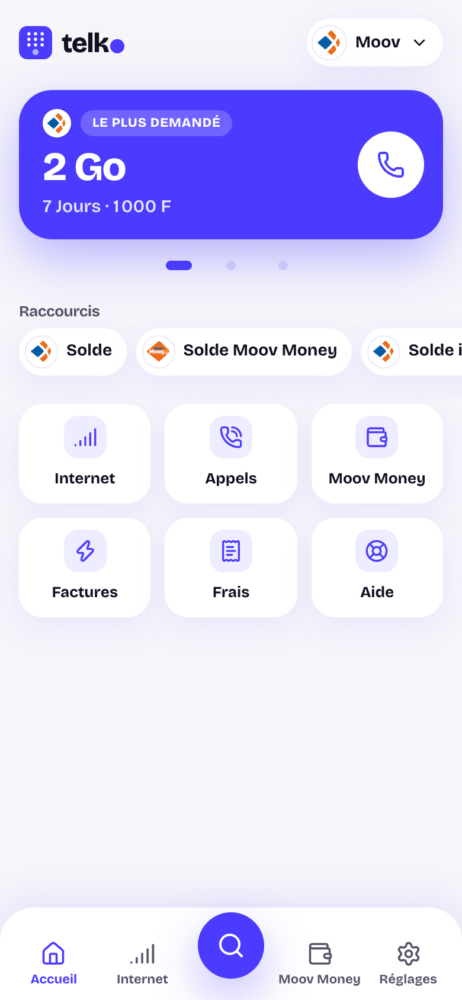
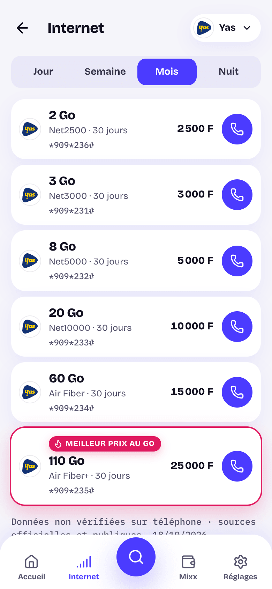
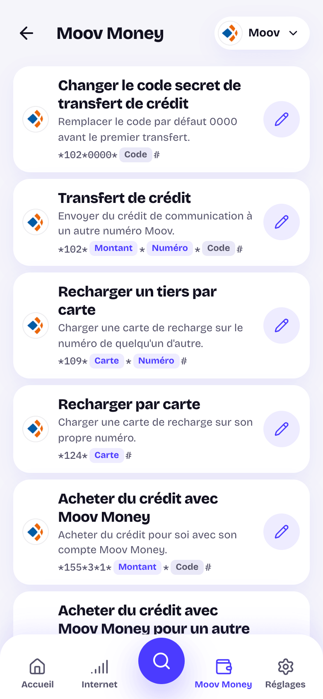

# Telko

**Mobile offers, mobile money and USSD codes across Africa, open and sourced.**

[](https://github.com/gausoft/telko/actions/workflows/ci.yml)
[](LICENSE)
[](data/LICENSE)

**Live: [telko.pages.dev](https://telko.pages.dev)**

Telko gathers, country by country, the data bundles, call plans, mobile money services, bill payments and USSD codes that African mobile users look for every day. Every entry shows where it comes from and when it was last checked. Tap an offer and the phone dialer opens with the code ready.

## Countries

| Country | Status | Operators |
|---|---|---|
| Togo | **Live** | Yas Togo with Mixx, Moov Africa Togo with Moov Money |
| Benin, Burkina Faso, Côte d'Ivoire, Guinea-Bissau, Mali, Niger, Senegal | Soon | Open to contributors |

Any country can join: the dataset, the pages and the offline mode are built per country. A country goes live when people who live there bring its data. **[Bring your country](CONTRIBUTING.md#add-a-country).**

<p align="center">
  
  
  
</p>

> **Status: early.** The Togo dataset (about 200 codes and 76 fee lines) comes from official and public sources and is **not verified on a real phone yet**. Each page says so. Always check the confirmation screen on your phone before a money transfer.

## Features

- **One tap to dial.** Every offer opens the dialer with its USSD code.
- **Code assistant.** Codes that need an amount, a phone number or a card number are built step by step. Telko never asks for your secret code: the operator's own menu does.
- **Works offline.** After a first visit, the pages of your country and operators stay available without a connection ([how](docs/offline.md)).
- **Search** across offers, codes and former brand names.
- **Sourced data.** Each entry carries its sources, its verification status and its date ([schema](docs/data-schema.md)).
- **Installable** as an app from the browser (Android and iPhone).

## Contributing

Most contributions need no code.

| You want to | Do this |
|---|---|
| Report a code that does not work | Open a [Broken code](https://github.com/gausoft/telko/issues/new?template=broken-code.yml) issue |
| Add an offer or fix a price | Open a [New offer](https://github.com/gausoft/telko/issues/new?template=new-offer.yml) issue, or edit the JSON file in `data/` |
| Confirm a code on your phone | Follow the [verification protocol](docs/verification-protocol.md) |
| Add your country | See [Add a country](CONTRIBUTING.md#add-a-country) |
| Work on the website | Read [CONTRIBUTING.md](CONTRIBUTING.md), then pick an issue labelled `good first issue` |

Never share your PIN, and never complete a real transfer to test a code.

## Run it locally

Requires Node.js 22 (see `.nvmrc`).

```bash
npm install
npm run dev      # http://localhost:4321
npm run verify   # types, data and unit tests, production build
```

## Repository layout

| Folder | Content |
|---|---|
| `data/` | The dataset: one folder per country, one JSON file per operator and category |
| `src/` | The website (Astro, static output). `src/lib/schema.ts` validates the dataset and types the pages |
| `scripts/` | Service worker and its build step |
| `public/` | Brand marks, flags and icons, each folder with its credits |
| `tests/` | Data, search and code builder tests |
| `docs/` | Data schema, verification protocol, offline mode, disclaimer, [architecture decisions](docs/decisions/) |

## Roadmap

See [ROADMAP.md](ROADMAP.md).

## Disclaimer

Telko is an independent community project, not affiliated with any operator. Codes and prices change. See [docs/disclaimer.md](docs/disclaimer.md).

## License

- **Code**: [MIT](LICENSE).
- **Data** (`data/`): [CC BY 4.0](data/LICENSE). Reuse it freely, with credit to "Telko contributors".
- **Brand marks** (`public/brands/`) belong to their owners and are not covered by either license.
